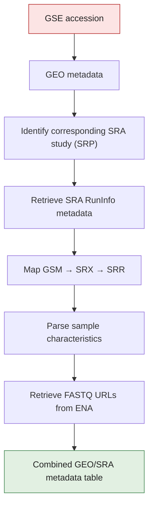

# dante 

## Retrieve GEO metadata and FASTQ download URLs

`dante` is an R package for retrieving and combining metadata from NCBI Gene Expression Omnibus (GEO) and Sequence Read Archive (SRA), and for obtaining FASTQ download URLs from the European Nucleotide Archive (ENA). Inspired from Dante's Inferno, Dante will help you to go through the 'messy' metadata and to recover the 'soul' of it - the FASTQ files!

The package is designed to simplify the process of going from a GEO study accession (GSE) to an analysis-ready metadata table containing GSM, SRX, SRR, sequencing information, and FASTQ download URLs.

## Features

`dante` currently provides functions to:

- Retrieve GEO study metadata from a GSE accession.
- Identify the corresponding SRA study (SRP).
- Retrieve SRA RunInfo metadata.
- Map GEO samples (GSM) to SRA experiments (SRX).
- Map SRA experiments (SRX) to sequencing runs (SRR).
- Parse GEO sample characteristics into separate metadata columns.
- Retrieve FASTQ URLs from ENA using SRR accessions.
- Add FASTQ URLs directly to the combined GEO/SRA metadata table.
  
         fastq_ftp : for downloading FASTQ files
  
         fastq_aspera : for alternative download of FASTQ files (fast download)
  
         fastq_md5 : for integrity check and verifying the download of FASTQ files


## Workflow



## Installation

### Development version from GitHub

The package is currently under development.

To install the development version from GitHub:

```r
# install.packages("devtools")
devtools::install_github("VanBortleLab/dante", auth_token = NULL)
```

# Downloading the metadata 

'dante' allows downloading metadata for both single and multiple studies. 

## for single study:

```r
gse <- "GSEid"
metadata <- get_complete_metadata("GSEid")
metadata_fastq <- add_fastq_urls(metadata)

write.csv(
  metadata_fastq,
  "GSEid_metadata_with_FASTQ.csv",
  row.names = FALSE
)
```
## for multiple studies - bulk download:

While downloading metadata for multiple GSE's, there can be two ways -

### 1. retrieving metadata as single GSE files: 

```r
# store your GSE accessions numbers
gse <- c("GSEid1", "GSEid2")

# Process and saving each GEO study separately
for (i in seq_along(gse)) {
  accession <- gse[i]
  message("Processing ", accession)
  
  metadata <- get_complete_metadata(accession)
  metadata_fastq <- add_fastq_urls(metadata)
  
  write.csv(
    metadata_fastq,
    paste0(accession, "_metadata_FASTQ.csv"),
    row.names = FALSE
  )

  message("Finished: ", accession)
}
```
### 1. retrieving metadata as a combined form: 

```r
gse <- c("GSEid1", "GSEid2")

# Retrieving metadata for each study
metadata_list <- lapply(gse, function(x) {
  message("Processing: ", x)
  df <- get_complete_metadata(x)
  df$GSE <- x
  return(df)
})
# Combining all studies
metadata <- bind_rows(metadata_list)

write.csv(
  metadata,
  "Combined_GEO_metadata.csv",
  row.names = FALSE
)
```


